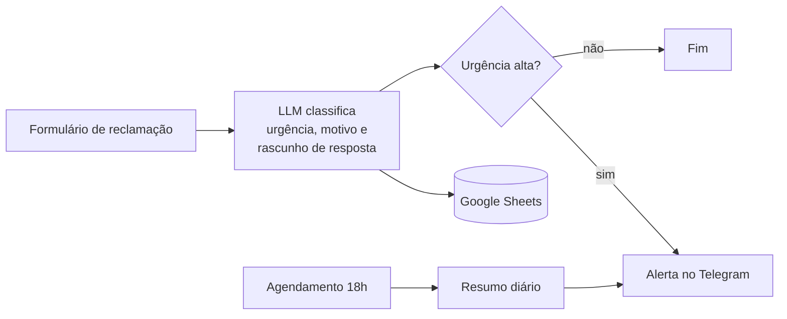

# ⚡ Triagem Automática de Reclamações com IA (n8n)

> 🚧 **Em desenvolvimento.** Este repositório tem a estrutura, o ambiente e o plano do fluxo; o workflow e os resultados estão sendo adicionados. Acompanhe o progresso no [roadmap](#roadmap).

Automação que recebe reclamações de clientes de um restaurante, usa um LLM para classificar **urgência** e **motivo**, sugere uma resposta, registra tudo numa planilha e avisa a equipe na hora quando o caso é urgente.

## Problema

Restaurantes de delivery recebem reclamações por vários canais e alguém precisa ler uma por uma para decidir o que é urgente. Triando à mão, uma pessoa gasta em torno de 2 minutos por reclamação (estimativa); com 50 por dia, são cerca de 1h40 diárias só lendo e classificando.

## Fluxo planejado



| Etapa | Nó no n8n | Saída |
|---|---|---|
| Gatilho | Form Trigger | nome, número do pedido e mensagem |
| Classificação | LLM (Gemini) | JSON com urgência (alta, média, baixa), motivo e rascunho de resposta |
| Registro | Google Sheets | uma linha por reclamação |
| Alerta | IF + Telegram | mensagem imediata se a urgência for alta |
| Resumo | Schedule Trigger | resumo das reclamações do dia às 18h |

## Como rodar o n8n

Pré-requisito: Docker.

```bash
docker compose up -d
```

Abra http://localhost:5678 e crie sua conta local. Para importar o fluxo (quando estiver disponível em `workflows/`): menu **⋯ → Import from File**.

As reclamações fictícias para teste estão em [exemplos/reclamacoes.csv](exemplos/reclamacoes.csv).

## Roadmap

- [x] Estrutura do repositório, ambiente Docker e reclamações de exemplo
- [ ] Gatilho por formulário e classificação com LLM
- [ ] Registro no Google Sheets
- [ ] Alerta de urgência no Telegram
- [ ] Resumo diário
- [ ] Workflow exportado em JSON, prints e vídeo de 1 minuto
- [ ] Medição: acerto da classificação nas reclamações de exemplo

## Estrutura

```
docker-compose.yml   n8n local com dados persistidos
workflows/           fluxo exportado do n8n (JSON)
exemplos/            reclamações fictícias para teste
docs/                prints e vídeo usados neste README
```

---

Feito por **Matteus Prado** · [LinkedIn](https://www.linkedin.com/in/matteus-prado-31b18a364) · [GitHub](https://github.com/MatGIT19)
